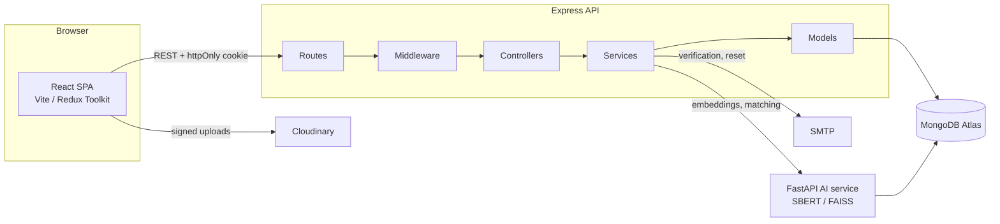

# Architecture

## System shape

Three deployable pieces. The client never talks to MongoDB or the AI service directly; the
Express API is the only component holding database credentials.



## Layering rules

Requests flow in one direction. Each layer may only call the one beneath it.

| Layer          | Responsibility                                          | Must not                          |
| -------------- | ------------------------------------------------------- | --------------------------------- |
| **Routes**     | Path, HTTP verb, middleware order, OpenAPI annotation   | Contain logic                     |
| **Middleware** | Auth, validation, rate limits, error translation        | Know about specific features      |
| **Controllers**| Read the request, call one service, shape the response  | Touch models or run queries       |
| **Services**   | Business rules, transactions, cross-model orchestration | Reference `req` or `res`          |
| **Models**     | Schema, indexes, instance helpers                       | Contain feature workflows         |

Controllers stay thin because that keeps business rules testable without HTTP. Services
throw `ApiError`, so the same rule produces the same status code no matter which route
calls it.

## Request lifecycle

A `POST /api/v1/auth/register` walks through:

1. `helmet`, `cors`, body parsers, `cookie-parser`, `compression`,
   `express-mongo-sanitize`, `hpp` — applied once in `app.js`.
2. `apiLimiter`, then the tighter `authLimiter` for credential endpoints.
3. `validate(registerSchema)` — Zod parses and **replaces** `req.body`, so the controller
   only ever sees coerced, whitelisted fields. Unknown keys are rejected, which is why a
   client cannot smuggle `role: "admin"` into a signup.
4. `authController.register` — wrapped in `asyncHandler`, so a rejected promise reaches the
   error middleware instead of hanging the socket.
5. `authService.register` — uniqueness check, user creation, verification token, email.
6. Response goes out through `sendSuccess`, giving every endpoint the shape
   `{ success, message, data, meta? }`.
7. Any thrown error lands in `errorHandler`, which maps Mongoose validation errors, cast
   errors and duplicate-key errors onto proper status codes and hides 5xx details in
   production.

## Authentication design

Two tokens with different jobs:

- **Access token** — a short-lived JWT (15 minutes) sent as a bearer header. Held only in
  browser memory. Never written to `localStorage`, so an XSS payload cannot read it.
- **Refresh token** — a 96-character random string in an `httpOnly`, `SameSite` cookie
  scoped to `/api/v1/auth`. Opaque rather than a JWT so it can be revoked server-side.

Only SHA-256 hashes of refresh tokens are stored, so a database dump cannot be replayed.
Every refresh rotates the token. If a token that was already rotated is presented again,
that means two parties hold the same token, so **all** sessions for the user are revoked.

Access tokens carry a custom `iatMs` claim. The standard `iat` claim has one-second
granularity, which cannot distinguish a token from a password change made in the same
second — the reason `hasPasswordChangedSince` compares milliseconds.

Enumeration is avoided deliberately: login returns one message for both an unknown account
and a wrong password, and `forgot-password` / `resend-verification` always return 200.

## Client architecture

Atomic design for presentation, feature folders for behaviour:

```
components/atoms       Button, Spinner, Skeleton, Alert, Logo
components/molecules   FormField, ThemeToggle, EmptyState
components/organisms   ToastHost
features/<name>/       slice + api + pages + components for one domain
```

State is split by concern: `auth` (session), `theme` (light/dark), `toasts` (transient
notifications). Server data lives in feature slices reached through thunks, and every
thunk rejects with the same normalized `{ message, status, fieldErrors }` shape so forms
can map server issues back onto individual inputs.

`apiClient` owns one piece of cross-cutting logic: on a 401 it refreshes once, retries the
original request, and collapses parallel 401s into a single refresh call. Login, register
and refresh itself are excluded to avoid loops.

On boot the app dispatches `restoreSession()`. Route guards render a loader while
`isInitializing` is true, so a hard reload does not bounce a signed-in user to `/login`.

## Testing strategy

| Scope       | Tool                                    | What it proves                         |
| ----------- | --------------------------------------- | -------------------------------------- |
| API routes  | Vitest + Supertest + mongodb-memory-server | Real HTTP against a real database   |
| API units   | Vitest                                  | Duration parsing, RBAC, password hooks |
| Client units| Vitest + Testing Library                | Reducers and component behaviour       |

The mailer is mocked in tests, which also lets the suite assert on the exact token that
would have been emailed — that is how the verification and reset flows are covered without
an inbox.
