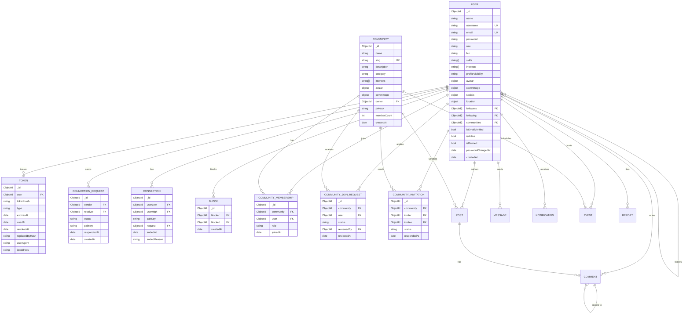

# Database

MongoDB accessed through Mongoose. Collections marked *planned* are designed but not yet
implemented — they arrive with their module.

## ER diagram

## `users` — implemented

Profile plus credentials in one document. Profile data is read on nearly every request, so
keeping it embedded avoids a join on the hot path.

| Field                    | Type       | Notes                                              |
| ------------------------ | ---------- | -------------------------------------------------- |
| `name`                   | String     | Required, ≤ 80 chars                               |
| `username`               | String     | Required, unique, lowercase, `^[a-z0-9_]+$`        |
| `email`                  | String     | Required, unique, lowercase                        |
| `password`               | String     | bcrypt hash, cost 12, `select: false`              |
| `role`                   | Enum       | `user` \| `moderator` \| `admin`, default `user`   |
| `profileVisibility`      | Enum       | `public` \| `private`, default `public`            |
| `avatar`, `coverImage`   | Subdoc     | `{ url, publicId }` — `url` is a validated http(s) image URL today; `publicId` is reserved for Cloudinary |
| `bio`                    | String     | ≤ 500 chars                                        |
| `skills`, `interests`    | [String]   | Lowercased, unique, capped at 20                   |
| `education`              | [Subdoc]   | School, degree, field, years (1800–2100)           |
| `experience`             | [Subdoc]   | Company, title, dates, description; `isCurrent` clears `endDate` |
| `projects`               | [Subdoc]   | Title, description, http(s) url, technologies      |
| `socials`                | Subdoc     | `github`, `linkedin`, `website`                    |
| `location`               | Subdoc     | `city`, `country`                                  |
| `followers`, `following` | [ObjectId] | Self-references                                    |
| `communities`            | [ObjectId] | Unused leftover; membership lives in `communitymemberships` |
| `isEmailVerified`        | Boolean    | Gates verified-only features                       |
| `isActive`, `isBanned`   | Boolean    | Deactivation and moderation                        |
| `passwordChangedAt`      | Date       | Invalidates older access tokens                    |
| `lastLoginAt`            | Date       | Set on every successful sign-in                    |

**Indexes**

| Index                                | Purpose                                  |
| ------------------------------------ | ---------------------------------------- |
| `{ email: 1 }` unique                | Login lookup, duplicate prevention       |
| `{ username: 1 }` unique             | Profile URLs, duplicate prevention       |
| `{ role: 1 }`                        | Admin filtering                          |
| `{ skills: 1 }`, `{ interests: 1 }`  | Multikey, used by matching and discovery |
| `{ name, username, bio }` text       | Keyword search before semantic search    |
| `{ occupation: 1 }`                  | Discovery by role                        |
| `{ location.city: 1 }`, `{ location.country: 1 }` | Discovery by place              |
| `{ profileVisibility: 1, username: 1 }` | Public directory lookups              |

Usernames in `RESERVED_USERNAMES` (`me`, `admin`, `settings`, …) are rejected at both
registration and rename so they cannot collide with `/users/me/*` routes.

The profile API never returns `password`. Public views also omit `email` and `role`.
Owner views add `completeness` and `embeddingSource` (bio + skills + interests +
occupation + education + experience + projects, joined) so the AI service can embed
without re-deriving field lists. Connected users may view a private profile; a user
who was blocked by the owner gets 404 rather than a private-profile 403.

## `tokens` — implemented

One collection for all three single-use or revocable token types, distinguished by `type`:
`refresh`, `email_verification`, `password_reset`.

| Field             | Type     | Notes                                             |
| ----------------- | -------- | ------------------------------------------------- |
| `user`            | ObjectId | Ref `User`, indexed                               |
| `tokenHash`       | String   | SHA-256 of the raw token; the raw value is never stored |
| `type`            | Enum     | Token purpose                                     |
| `expiresAt`       | Date     | TTL index removes the document automatically      |
| `usedAt`          | Date     | Set when consumed or rotated                      |
| `revokedAt`       | Date     | Set on logout, reset, or reuse detection          |
| `replacedByHash`  | String   | Rotation chain; its presence marks a reused token |
| `userAgent`, `ipAddress` | String | Session context for the future sessions UI |

**Indexes**

| Index                                             | Purpose                        |
| ------------------------------------------------- | ------------------------------ |
| `{ tokenHash: 1 }`                                | Verification lookup            |
| `{ user: 1, type: 1 }`                            | Revoke all sessions of a user  |
| `{ expiresAt: 1 }` with `expireAfterSeconds: 0`   | Automatic cleanup              |

## `connectionrequests` — implemented

Directed requests. Rows are never deleted: accept/reject/cancel only change `status`.

| Field         | Type     | Notes |
| ------------- | -------- | ----- |
| `sender`      | ObjectId | Ref `User` |
| `receiver`    | ObjectId | Ref `User`; cannot equal `sender` |
| `status`      | Enum     | `pending` \| `accepted` \| `rejected` \| `cancelled` |
| `pairKey`     | String   | Sorted `idA:idB` so direction does not matter |
| `respondedAt` | Date     | Set when the pending row is resolved |

**Indexes**

| Index | Purpose |
| ----- | ------- |
| `{ receiver: 1, status: 1, createdAt: -1 }` | Incoming inbox |
| `{ sender: 1, status: 1, createdAt: -1 }` | Outgoing list |
| `{ pairKey: 1, status: 1 }` | History for a pair |
| unique `{ pairKey: 1 }` where `status: pending` | At most one live request per pair |

## `connections` — implemented

Undirected accepted edge. `userLow` / `userHigh` are the two ids in lexicographic order.

| Field         | Type     | Notes |
| ------------- | -------- | ----- |
| `userLow`, `userHigh` | ObjectId | Ordered pair |
| `pairKey`     | String   | Same as requests |
| `request`     | ObjectId | The request that created this edge |
| `endedAt`     | Date     | `null` while active |
| `endedReason` | Enum     | `removed` \| `blocked` |

**Indexes**

| Index | Purpose |
| ----- | ------- |
| `{ userLow: 1, endedAt: 1 }`, `{ userHigh: 1, endedAt: 1 }` | Friend lists |
| unique `{ pairKey: 1 }` where `endedAt: null` | One live edge per pair |

Reconnect after remove creates a **new** row so history is preserved.

## `blocks` — implemented

Directed hide. Unique `{ blocker, blocked }`. Blocking cancels pending requests and
soft-ends an active connection (`endedReason=blocked`). Historical request/connection
rows stay. Either direction of a block forbids new requests and hides both users from
each other's discovery results. The blocked user cannot fetch the blocker's public
profile (404). Only the blocker can unblock.

**Indexes:** unique `{ blocker: 1, blocked: 1 }`, `{ blocked: 1 }`, `{ blocker: 1, createdAt: -1 }`.

### Query-plan notes

Incoming/outgoing inboxes are covered by the `(user, status, createdAt)` indexes and
are paginated. Friend lists use the `endedAt: null` partial unique plus the
`userLow`/`userHigh` indexes. Mutual counts load the viewer's friend ids, then all
edges touching the page of target ids, and intersect in memory — O(friends of the
page), not O(users). Name/username discovery uses escaped case-insensitive regex,
which cannot use the text index for a leading-wildcard match; that is acceptable at
current scale. Phase 9 replaces ranking, not this filter path.

## `communities` — implemented

Community metadata only. Members live in `communitymemberships`.

| Field         | Type     | Notes |
| ------------- | -------- | ----- |
| `name`        | String   | ≤ 80 chars |
| `slug`        | String   | Unique, lowercase, URL-safe; stable after create |
| `description` | String   | ≤ 2000 chars, HTML stripped |
| `category`    | Enum     | technology, science, arts, career, education, health, sports, gaming, music, other |
| `interests`   | [String] | Lowercased, capped at 20 |
| `avatar`, `coverImage` | Subdoc | `{ url, publicId }` — http(s) URL today |
| `owner`       | ObjectId | Ref `User`; must match the owner membership |
| `privacy`     | Enum     | `public` \| `private` |
| `memberCount` | Number   | Maintained with `$inc`; unique membership index prevents doubles |

**Indexes:** unique `{ slug }`, `{ owner }`, `{ category, createdAt }`, `{ interests }`, `{ privacy, createdAt }`, `{ createdAt }`, text on name/description/slug/category.

## `communitymemberships` — implemented

One row per user per community. Unique `{ community, user }`.

| Field       | Type     | Notes |
| ----------- | -------- | ----- |
| `community` | ObjectId | Ref `Community` |
| `user`      | ObjectId | Ref `User` |
| `role`      | Enum     | `owner` \| `moderator` \| `member` |
| `joinedAt`  | Date     | |

**Indexes:** unique `{ community, user }`, `{ community, role }`, `{ user, createdAt }`, `{ community, joinedAt }`.

## `communityjoinrequests` — implemented

Private-community applications. Unique pending `{ community, user }`.

| Field        | Type     | Notes |
| ------------ | -------- | ----- |
| `community`  | ObjectId | |
| `user`       | ObjectId | Applicant |
| `status`     | Enum     | `pending` \| `approved` \| `rejected` \| `cancelled` |
| `reviewedBy` | ObjectId | |
| `reviewedAt` | Date     | |

**Indexes:** unique pending `{ community, user }`, `{ community, status, createdAt }`, `{ user, status, createdAt }`.

## `communityinvitations` — implemented

Staff-issued invites. Unique pending `{ community, invitee }`.

| Field       | Type     | Notes |
| ----------- | -------- | ----- |
| `community` | ObjectId | |
| `inviter`   | ObjectId | Owner or moderator |
| `invitee`   | ObjectId | |
| `status`    | Enum     | `pending` \| `accepted` \| `rejected` \| `cancelled` |
| `respondedAt` | Date   | |

**Indexes:** unique pending `{ community, invitee }`, `{ invitee, status, createdAt }`, `{ community, status, createdAt }`.

Transactions wrap create / join / approve / leave / transfer / delete when the
deployment is a replica set. Local `mongodb-memory-server` is standalone, so those
paths fall back to sequential writes plus unique indexes.

## Planned collections

| Collection        | Module | Key fields                                                                  |
| ----------------- | ------ | --------------------------------------------------------------------------- |
| `posts`           | 6      | `author`, `community`, `type` (text/image/video/poll), `content`, `media[]`, `poll`, `likes[]`, `savedBy[]`, `commentCount`, `sentiment` |
| `comments`        | 6      | `post`, `author`, `parent` (self-ref for replies), `content`, `likes[]`, `toxicityScore` |
| `messages`        | 8      | `conversation`, `sender`, `body`, `attachments[]`, `readBy[]`, `deliveredAt` |
| `conversations`   | 8      | `participants[]`, `isGroup`, `name`, `lastMessage`, `admins[]`               |
| `notifications`   | 7      | `recipient`, `actor`, `type`, `entity`, `entityModel`, `isRead`              |
| `events`          | 9      | `host`, `community`, `title`, `startsAt`, `location`, `poster`, `attendees[]`, `rsvps[]` |
| `reports`         | 14     | `reporter`, `targetType`, `target`, `reason`, `status`, `resolvedBy`         |
| `adminLogs`       | 14     | `admin`, `action`, `targetType`, `target`, `metadata`, `createdAt`           |
| `userEmbeddings`  | 10     | `user`, `vector` (float[384]), `model`, `sourceHash`, `updatedAt`            |

## Conventions

- Every schema uses `timestamps: true`.
- References are always `ObjectId` with an explicit `ref`, never denormalized strings.
- Arrays that can grow without bound (post likes at scale, community members) move to
  their own collection when a module needs pagination over them.
- `autoIndex` is enabled outside production; production builds indexes through a migration
  so a deploy cannot be slowed down by an index build.
